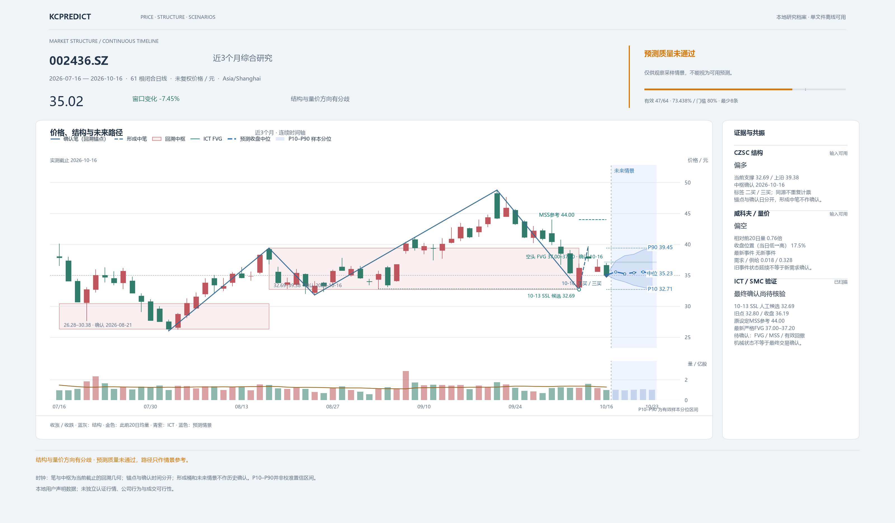

# KCPredict

KCPredict 是可单独安装的本地结构分析与未来路径预测工具。安装包包含独立 Python 入口、冻结的 CZSC 原生引擎和 Kronos 推理源码；运行不需要 KHQuant 项目、服务或数据库。普通分析不联网，不自动下载行情或模型，不执行交易。

[下载 v0.0.2](https://github.com/zhaozhenxiong/KCPredict/releases/tag/v0.0.2) · [版本记录](CHANGELOG.md)

## 可视化效果

最近3个月的 **CZSC 结构、威科夫量价、ICT/SMC 与未来5个交易日预测**，沿同一条时间轴展示；HTML、PNG 和 SVG 共用视觉主题。



[下载离线演示包](https://github.com/zhaozhenxiong/KCPredict/raw/refs/heads/main/docs/assets/kcpredict-showcase-64.zip) · [交互 HTML 文件](docs/assets/kcpredict-showcase-64.html) · [高清 PNG](docs/assets/kcpredict-showcase-64.png) · [矢量 SVG](docs/assets/kcpredict-showcase-64.svg) · [功能导览](docs/showcase.md)

固定历史展示样例：`002436.SZ`，截至 **2026-10-16**；64条采样中47条有效（73.4375%），**预测质量未通过**。蓝色未来路径仅为模型采样情景。HTML 下载后可离线打开；GitHub 文件页显示源码，不会直接执行交互。

- **证据放在一起**：确认笔、中枢、量能、流动性候选与严格 FVG 同图查看，支持和冲突各自保留。
- **细节可交互**：缩放、平移、逐日数值、图层开关，以及确认时间、生命周期和预测分位明细。
- **质量可复核**：明确通过／未通过／不可用／未执行，展示真实有效样本数、比例和门槛。

## 运行环境

- Python **3.12（64 位）**。
- 结构分析使用发行包内的冻结原生引擎：**macOS Apple Silicon（arm64）**、**Windows x64（AMD64）**。当前随包二进制不支持 Linux 或 Intel Mac；这些平台需要从相同冻结来源构建匹配引擎并核验身份，不能替换成 PyPI 的其他 CZSC 版本。
- 预测额外需要 PyTorch 等依赖和单独准备的 Kronos-base / Kronos-Tokenizer-base 权重。CPU 可运行；`auto` 根据实际可用环境选择 CUDA、MPS、CPU，明确指定不可用设备会报错。
- 源码附有上方说明的固定可视化展示样例；个人行情库、运行日历、模型权重、账户、密钥和本机状态不随包提供。预测模型文件合计约 **425 MB**；Python 和 PyTorch 安装另占磁盘空间。

本次实际安装验证平台和执行结果见 [VERIFICATION.md](VERIFICATION.md)。Windows、Linux、Intel Mac 未经实机验证，不等同于已通过兼容性测试。

## 独立安装

将整个 KCPredict 发行目录解压到新电脑的普通可写文件夹。安装 Python 3.12 后，在该目录运行：

macOS：

```sh
sh install.sh
.venv/bin/kcpredict status
.venv/bin/kcpredict serve --host 127.0.0.1 --port 8130
```

Windows（命令提示符）：

```bat
install.bat
.venv\Scripts\kcpredict.exe status
.venv\Scripts\kcpredict.exe serve --host 127.0.0.1 --port 8130
```

也可以直接运行 `python3.12 install.py` 或 `py -3.12 install.py`。安装器只在当前发行目录创建 / 使用 `.venv`，用官方 PyPI 安装本包及依赖，不修改系统 Python，不读取另一项目的 `.env`。安装结束后访问 <http://127.0.0.1:8130/>。

只做结构分析、暂不安装 PyTorch：

```sh
python3.12 install.py --no-predict
```

后续再次运行 `install.py` 即可补装预测依赖。`status` 可在没有行情和权重时运行，并报告尚未准备的资产。

### 在 Codex 中使用 KCPredict skill

源码发行包的 `skill/` 是可独立迁移的技能目录。将整个目录复制到目标电脑的 `~/.codex/skills/kcpredict/`，确保该目录下直接是 `SKILL.md`，旁边保留 `agents/`、`references/`、`scripts/` 和 `assets/`。其中 `assets/` 同时包含 `composite.html` 模板与 `report-theme.json` 主题，迁移时还须保留 `scripts/kcpredict_theme.py`；生成后的 `composite.html` 已全内嵌，可单独离线分享。然后为 Codex 进程设置 `KCPREDICT_PYTHON`，指向刚安装的 KCPredict 虚拟环境 Python：

```sh
export KCPREDICT_PYTHON="/path/to/KCPredict/.venv/bin/python"
```

Windows 的对应路径是 `C:\path\to\KCPredict\.venv\Scripts\python.exe`，可在启动 Codex 的命令提示符中先执行 `set KCPREDICT_PYTHON=C:\path\to\KCPredict\.venv\Scripts\python.exe`，或在用户环境变量中保存该值。也可以在启动 Codex 前激活该虚拟环境，让 `kcpredict` 在其 `PATH` 中可用。技能不会猜另一项目的位置，也不会自动启动旧服务。

技能已整合 [ICT Trading Model](https://github.com/carreypro/ict-trading-model) 的方法与本地扫描器。现在说“分析某只股票”，默认交付**最近3个月的结构、量价、ICT与未来5个交易日预测单文件 HTML 交互综合图**，附 PNG/SVG 预览；历史与未来沿同一条时间轴连续衔接，实际行情截止线明确区分事实和采样情景。图内标明预测质量通过／未通过／不可用／未执行。技能工作流默认使用64条采样、128根模型历史、种子42；独立 CLI 低层默认采样仍为8，用户指定参数优先。ICT 派生结果保留独立的机械状态；最终结论仍需核查高周期、数据质量和净盈亏比。沪深日周月不套用纽约盘中时段，也不从预测样本确认历史信号。

示例：`使用 $kcpredict 综合分析 002436.SZ 截至 2026-10-16 的结构、量价和 ICT，列出共振、冲突与缺失证据，再预测未来 5 个交易日。` 数据、核验日历和固定模型仍按下文单独准备。

默认综合图工作流：

```sh
.venv/bin/python skill/scripts/kcpredict_report.py --symbol 002436.SZ --end 2026-10-16
```

输出独立的新目录，包含可离线打开的 `composite.html`、PNG、SVG、各方法 JSON、预测质量和文件身份审计。HTML 内嵌数据和交互代码，不依赖 CDN 或网页服务。HTML、PNG/SVG 以 HTML 为视觉基准，共用 `report-theme.json` 的配色、字体和版式，并记录同一主题身份。预测失败仍尽量保留结构、量价、ICT及原因面板；交互、布局和导出沿用原有已评估路径，不修改参数或放宽门槛。已有 JSON 美化可直接运行 `skill/scripts/kcpredict_chart.py`，再用 `skill/scripts/kcpredict_html.py --data 新图目录/chart-data.json --output 新图目录/composite.html` 生成交互文件，无需重跑模型。HTML 生成器只用标准库，PNG/SVG 需要 Matplotlib；详细参数与人工标注格式见 [综合图工作流](skill/references/chart-workflow.md)。

已有 CLI JSON 可直接附加 ICT 扫描，无需再次运行模型：

```sh
python3 skill/scripts/kcpredict.py --output ./research.json analyze --symbol 002436.SZ --end 2026-10-16
python3 skill/scripts/kcpredict_ict.py --input ./research.json --frequency 日线 --output ./ict.json
```

`kcpredict_ict.py` 只读取真实、已闭合且不晚于研究截止的 OHLCV，排除形成中的周／月桶，保留输入文件 SHA、来源和缺失资格；少于 10 根闭合 K 线时返回 `unavailable`。技能还可用 `skill/scripts/ict_scan.py --input ./candles.json` 扫描用户提供的通用 OHLCV JSON，或按规则解读截图；通用扫描器并不扩展 KCPredict 运行时支持的市场与周期。详细方法、输入格式及来源许可证见 [技能入口](skill/SKILL.md) 和 [ICT 整合说明](skill/references/ict-integration.md)。安装时应复制整个 `skill/` 目录；单独安装 Python wheel 不包含技能文件。

有 Python 包管理经验时，也可在自建 Python 3.12 虚拟环境中安装发行 wheel：

```sh
python -m pip install "/path/to/kcpredict-0.0.3-py3-none-any.whl[predict,charts]"
kcpredict status
```

wheel 的 `py3-none-any` 标签用于包含多平台资源的 Python 分发；实际结构引擎仍只支持上面列出的 Python / 系统 / 架构组合。

## 数据与状态目录

默认用户状态独立保存在 `~/.kcpredict`，模型放在其下 `models/kronos/`。可通过环境变量 `KCPREDICT_HOME` 指向新电脑上的独立可写目录；它不会自动读取 KHQuant 数据。迁移已有状态时，应先停止 KCPredict，再复制该独立目录，并在新电脑运行 `status` 重新核验。

### 导入日线

准备自己的 UTF-8 CSV，至少包含：

```csv
date,open,high,low,close,volume,amount
2026-10-14,10.00,10.35,9.95,10.20,1500000,15300000
2026-10-15,10.22,10.48,10.10,10.40,1800000,18600000
```

这里仅演示列格式，不能作为真实分析样本。日线必须为已核验的未复权 OHLC；`volume` 是股数，`amount` 是人民币成交额。不要将“手”或“万元”的数值直接当作这些单位。导入时必须明确声明数据契约：

```sh
kcpredict data import-csv ./my_daily.csv --symbol 002436.SZ \
  --verified-unadjusted --volume-unit shares --amount-unit CNY
```

只接收沪深股票，排除北交所。导入真实数据前，请自行核实证券代码、来源、日期、复权方式、成交量和成交额单位；命令中的确认标志不是对第三方数据自动背书。

上面的最小列格式可供查看几何结构。完整来源信号和预测可用性还依赖 CSV 原有的 `source` 与 `has_trade_price` 列：保留实际数据提供方的冻结来源标识，真实交易价核验列为 `1`。来源未知或缺失时，系统保存为 `csv_unverified`，来源信号 / 量价资格保持不可用，预测结果也不会被标为可用。当前预测合格来源限于已核验的 `sina_unadjusted_v1`、`fuyao_unadjusted_v1`；不要为了通过检查给未知数据补写这些名称。`--verified-unadjusted` 本身不会改变这个限制。

### 导入交易日历

另外准备已经核实的交易日历 CSV，包含一列 `date`，每行是实际开市日，按日期递增且不重复。分析周 / 月闭合与预测未来日期依赖这份日历；不得用普通工作日替代节假日核验。

```csv
date
2026-10-14
2026-10-15
2026-10-16
2026-10-19
2026-10-20
```

以上日期同样仅展示格式。导入自己的完整核验日历：

```sh
kcpredict data import-calendar ./my_verified_calendar.csv --verified
```

预测需要足够的历史输入与未来开市日；缺失时会明确失败，不推测、不替换成过时收盘价。

## 准备模型（一次）

模型没有随安装包复制。选择一种明确操作：

```sh
# 显式联网下载固定版本的公开官方模型，并核验文件身份
kcpredict models download

# 或从已经准备好的独立模型目录导入，并核验文件身份
kcpredict models import /path/to/kronos
```

导入目录结构：

```text
kronos/
  config.json
  model.safetensors
  tokenizer/
    config.json
    model.safetensors
```

固定模型来源：`NeoQuasar/Kronos-base` revision `2b554741eca47781b64468546e77fef3e85130e6`，tokenizer 为 `NeoQuasar/Kronos-Tokenizer-base` revision `0e0117387f39004a9016484a186a908917e22426`。只接受匹配的模型和配置。安装本身、`status`、`analyze`、`predict`、`run` 不会隐式下载权重。

## 命令行使用

以下命令需要先激活 `.venv`，或把 `kcpredict` 替换成上面对应的 `.venv` 可执行文件路径：

```sh
kcpredict status
kcpredict analyze --symbol 002436.SZ --end 2026-10-16
kcpredict predict --symbol 002436.SZ --end 2026-10-16
kcpredict run --symbol 002436.SZ --end 2026-10-16
kcpredict serve --host 127.0.0.1 --port 8130
kcpredict --help
```

`analyze` 提供结构与量价证据；`predict` 使用独立本地权重生成路径样本；`run` 组合二者。具体可选参数以各子命令 `--help` 为准。预测是随机采样的条件路径，结构来源信号与模型预测各自保留身份，不构成自动买卖指令或收益保证。

## 完全离线安装

离线运行与离线安装是两件事。离线电脑仍需先安装 Python 3.12，并提前准备**与目标系统、CPU 架构、Python 3.12 匹配**的全部 Python wheels（包含构建依赖 `setuptools`、`wheel` 和传递依赖）。不要把 Mac wheels 当作 Windows wheelhouse 使用。

在与目标机器平台相同的联网 Python 3.12 环境中，先下载依赖到 `wheelhouse/`：

```sh
python -m pip download --index-url https://pypi.org/simple --only-binary=:all: \
  --dest ./wheelhouse 'setuptools>=77,<83' 'wheel>=0.45,<1' \
  'numpy>=2.0,<3' 'pandas>=2.2,<4' 'torch>=2.6,<3' \
  'einops>=0.8,<0.9' 'safetensors>=0.5,<1' 'tqdm>=4.67,<5' \
  'matplotlib>=3.9,<4'
```

Windows 命令提示符请将上面写成一行，并将单引号改成双引号。复制 KCPredict 源发行目录和整个 wheelhouse 到目标电脑后运行：

```sh
python3.12 install.py --offline --wheelhouse /path/to/wheelhouse
```

`--offline` 禁用包索引，缺 wheel 会失败。只装结构版本时添加 `--no-predict`，可省略 PyTorch 等预测依赖。行情、核验日历和固定版本权重也要单独带到离线电脑，再执行导入。

## 来源与边界

CZSC 和 Kronos 的冻结来源、文件 SHA 与许可证随包资源保留。结构引擎直接从已核验的内置资源加载，不运行 `pip install czsc`。不要直接替换原生 wheel、冻结算法或模型文件；不匹配的内容会被拒绝。依赖限定在受控版本范围内，但不同硬件和浮点后端不承诺随机预测逐位一致。

本工具不提供行情下载、全市场扫描、训练、模型晋升、模拟账户或交易执行。用户自己的行情和模型始终由独立状态目录管理；源码发行文件夹可整体复制，已经创建的 `.venv` 应在另一台电脑重新安装，不能跨平台直接搬运。
